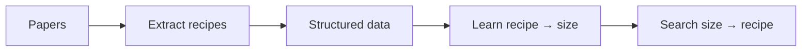

# The Idea Behind a ZIF-8 Crystal-Size Pipeline

> A short note on the thinking behind a group project, before any results.

## The problem

ZIF-8 is easy to make and hard to make *to size*. Temperature, time, zinc source, 2-methylimidazole concentration, solvent, modulators, stirring — change one and the particle size can move a lot. For drug delivery that matters: a 50 nm particle and a 500 nm particle are not the same material in practice.

At the same time, twenty years of literature already contains a huge number of recipe → size examples. They're just buried in free-text experimental sections, one paper at a time.

## The idea

Instead of treating every new synthesis as a fresh round of trial and error, treat the literature as a dataset:

1. **Extract** synthesis conditions from papers and turn them into a structured table.
2. **Learn** a model that maps a recipe to a particle size.
3. **Invert** the model: given a target size, search for recipes that should land there.

That's the whole pitch. The appeal is that it turns scattered experimental knowledge into something queryable, and it gives experimentalists a starting point instead of a blank parameter space.

## What makes the idea tricky

The interesting part isn't the model — it's everything around it.

**The literature is biased.** Papers report syntheses that worked. The failures never become data, so a model trained on papers only ever sees the safe part of the parameter space. Ask it to search freely and it may happily propose conditions no one has tried because no one could make them work.

**"Size" is not one number.** DLS, TEM, SEM, SAXS, and Scherrer estimates all describe related but different things. Put them in one column and you've added noise before training even starts.

**A recipe is more than its variables.** A solvent flag often stands in for a whole protocol: addition order, aging, atmosphere, who did the experiment. The model can learn the label without learning the chemistry.

**The model is a proxy.** Any inverse-design result is only as good as the forward model, and the forward model has never been tested outside the literature it was trained on. A recipe that looks perfect on paper still has to survive the bench.

## Why it's still worth doing

None of these problems make the idea bad — they just define what the idea actually is. It's not an oracle. It's a way to compress what the field already knows into a usable prior, so the next experiment starts somewhere informed rather than at random.

The real test comes later: make a few of the proposed recipes, measure what actually happens, and feed the results back. Until then, it's a well-organized hypothesis generator — which, honestly, is already useful.

---

*Personal notes; the project repo is [here](https://github.com/WangLab-XJTU/ZIF-8_Data_Pipeline).*
